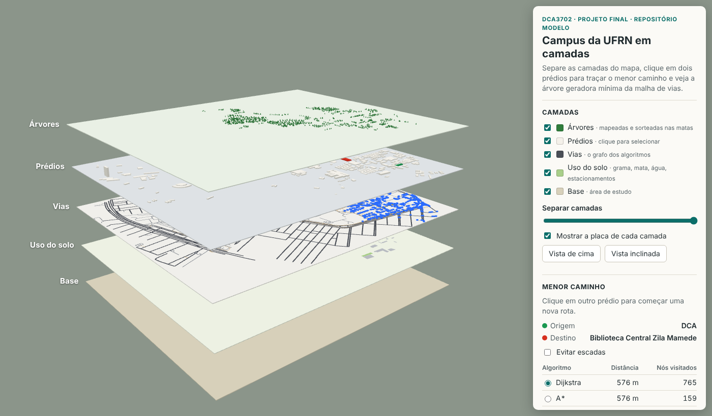
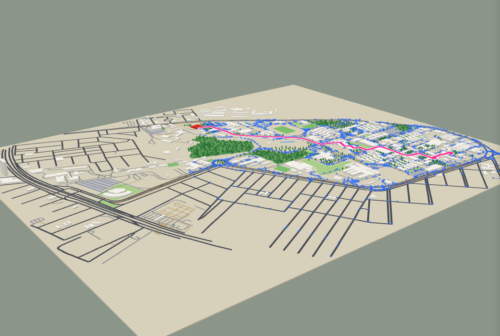
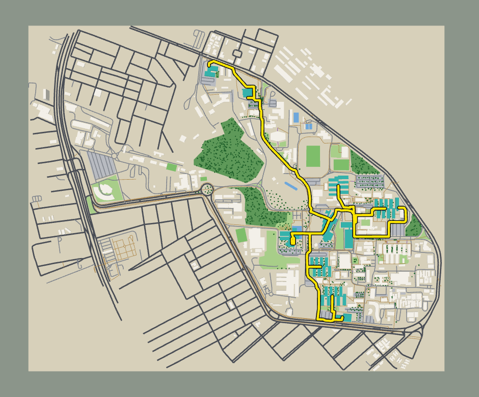

# Campus da UFRN em camadas

> **Repositório modelo do projeto final de DCA3702 (Algoritmos e Estrutura de Dados II, UFRN).**
> Ele mostra a organização esperada de um repositório de entrega e traz uma página interativa completa como exemplo. Para usar como ponto de partida, clique em **Use this template** no GitHub e troque o conteúdo pelo do seu projeto.

**Página interativa** → `https://SEU-USUARIO.github.io/NOME-DO-REPOSITORIO/`
**Vídeo de apresentação (até 15 min)** → `https://youtu.be/LINK-DO-VIDEO`



## Equipe

| Nome completo | Matrícula | Participação no trabalho |
| --- | --- | --- |
| Nome Completo da Pessoa 1 | 20260000001 | Coleta e preparação dos dados, testes |
| Nome Completo da Pessoa 2 | 20260000002 | Algoritmos e validação com NetworkX |
| Nome Completo da Pessoa 3 | 20260000003 | Página web e vídeo |

## O problema

Quem circula a pé pelo campus da UFRN escolhe caminhos de forma intuitiva. Este projeto modela as vias e calçadas do campus como um grafo e responde a três perguntas.

1. Qual é o menor caminho a pé entre dois prédios, e quanto ele muda quando as escadas são evitadas?
2. Quanto trabalho o A\* economiza em relação ao Dijkstra para chegar à mesma resposta?
3. Qual é o menor comprimento de passarela coberta que permite ir de qualquer prédio de aulas a qualquer outro sem sair da cobertura?

## O que a página permite

A página publicada em `docs/` roda inteira no navegador, sem servidor.

| Recurso | O que o visitante faz | Conteúdo da disciplina |
| --- | --- | --- |
| Camadas | Liga e desliga base, uso do solo, vias, prédios e árvores, e separa as camadas na vertical | Modelagem do problema |
| Menor caminho | Clica em dois prédios e compara distância e nós visitados | Dijkstra e A\* |
| Evitar escadas | Refaz a rota sem as arestas do tipo escada | Efeito do peso e das restrições |
| Passarela coberta | Marca os prédios a ligar e acompanha cada ligação sendo aceita ou descartada | Dijkstra e Kruskal encadeados |

## Resultados

Os números abaixo são os do grafo publicado e podem ser conferidos na página.

| Medida | Valor |
| --- | --- |
| Nós e arestas do grafo de vias | 4.334 nós e 4.910 arestas |
| Rota do DCA à Biblioteca Central Zila Mamede | 576 m |
| Nós visitados nessa rota | 765 com Dijkstra e 159 com A\* |
| Passarela que liga os 11 prédios de aula e serviços | 3,43 km de calçada a cobrir |
| Ligações examinadas pelo Kruskal nesse caso | 55, com 10 aceitas e 45 descartadas por fecharem ciclo |

O A\* chega à mesma distância visitando cerca de um quinto dos nós, porque a distância em linha reta até o destino orienta a busca.



Na passarela, a soma das dez ligações aceitas é de 3,91 km, mas o comprimento a construir cai para 3,43 km, porque algumas ligações passam pelo mesmo trecho de calçada e ele só precisa ser coberto uma vez.



### Como a passarela é calculada

1. Dijkstra parte de cada prédio marcado e mede a distância a pé até todos os outros.
2. Essas distâncias formam um grafo completo, em que cada prédio marcado é um vértice.
3. Kruskal examina as ligações da mais curta para a mais longa e descarta as que fechariam um ciclo.
4. Cada ligação aceita volta a ser um caminho de calçadas no mapa.

Ligar um subconjunto de pontos por dentro de uma rede é o problema da árvore de Steiner, que não tem solução exata eficiente. O procedimento acima é a aproximação clássica, e o custo obtido é no máximo o dobro do ótimo.

## Estrutura do repositório

```
.
├── README.md                  este arquivo
├── data/                      dados brutos e a origem de cada um
│   ├── ufrn_campus.osm
│   └── README.md
├── notebooks/                 exploração e obtenção dos dados
│   └── 01_campus_3d_osm2world.ipynb
├── src/                       código que transforma os dados
│   └── gerar_camadas.py
├── docs/                      página publicada pelo GitHub Pages
│   ├── index.html
│   ├── css/estilo.css
│   ├── js/app.js              cena 3D e interface
│   ├── js/algoritmos.js       Dijkstra, A* e Kruskal
│   ├── data/camadas.json      gerado por src/gerar_camadas.py
│   └── vendor/                three.js, copiado para a página não depender de CDN
├── tests/                     conferência dos algoritmos com o NetworkX
├── requirements.txt
└── package.json
```

## Como reproduzir

```bash
# 1. Gerar os dados da página a partir do arquivo do OpenStreetMap
python src/gerar_camadas.py

# 2. Abrir a página no computador (a página precisa de um servidor, não abre por duplo clique)
python -m http.server 8000 --directory docs
# depois acesse http://localhost:8000

# 3. Rodar os testes
pip install -r requirements.txt
python tests/test_grafo.py     # regrava a referência calculada pelo NetworkX
pytest                         # confere o grafo
npm test                       # confere Dijkstra, A* e Kruskal da página com a referência
```

Para usar outra área, baixe um novo arquivo `.osm` com o notebook em `notebooks/` e repita o passo 1.

## Como publicar a página

1. Envie o repositório para o GitHub.
2. Abra **Settings → Pages**.
3. Em **Build and deployment**, escolha **Deploy from a branch**, o ramo `main` e a pasta `/docs`.
4. Aguarde cerca de um minuto e acesse o endereço mostrado na mesma tela.
5. Atualize o link da página no topo deste README.

## Dados e licenças

| Item | Origem | Licença |
| --- | --- | --- |
| Mapa do campus | [OpenStreetMap](https://www.openstreetmap.org/copyright), baixado pela API Overpass | ODbL |
| three.js | [mrdoob/three.js](https://github.com/mrdoob/three.js), versão 0.170 | MIT |
| Código deste repositório | Autores | MIT |

## Limitações

- Os prédios sem altura no OpenStreetMap aparecem com 6 m.
- Cada prédio é ligado ao nó do grafo mais próximo do seu centro, e não à porta de entrada.
- O terreno é plano. O relevo do campus não entra no custo das rotas.
- A passarela calculada é uma aproximação, e não o menor comprimento possível. Ela também ignora as passarelas que já existem no campus.
- As árvores dentro das matas são sorteadas para dar volume, e não correspondem a árvores mapeadas.

## Declaração de uso de IA

O uso de IA é permitido no projeto, desde que declarado. A tabela abaixo é a declaração deste repositório modelo e serve de exemplo de preenchimento.

| Modelo | Etapa | Como foi usado | Como o resultado foi revisado |
| --- | --- | --- | --- |
| Claude (Anthropic), modelos Fable 5.2 e Opus 5.5 | Notebook de obtenção dos dados | Pedido de um notebook para baixar o campus do OpenStreetMap e convertê-lo em 3D | Executado no Colab, com correções a cada erro encontrado |
| Claude (Anthropic), modelo Fable 5.2 | Script de dados, página web e testes | Pedido de uma página em camadas com Dijkstra, A\* e Kruskal no navegador, e depois da troca do exemplo de Kruskal pelo da passarela coberta | Resultados comparados com o NetworkX pelos testes em `tests/` e página conferida visualmente |
| Claude (Anthropic), modelo Fable 5.2 | Este README | Redação da primeira versão | Lido e ajustado pelo professor |

## Lista de conferência da entrega

- [ ] README com nome completo dos integrantes e a divisão do trabalho
- [ ] Link da página web funcionando
- [ ] Link do vídeo de até 15 minutos, com todos os integrantes e a câmera aberta
- [ ] Declaração de uso de IA preenchida
- [ ] Instruções para reproduzir os resultados
- [ ] Submissão feita com o link deste repositório
